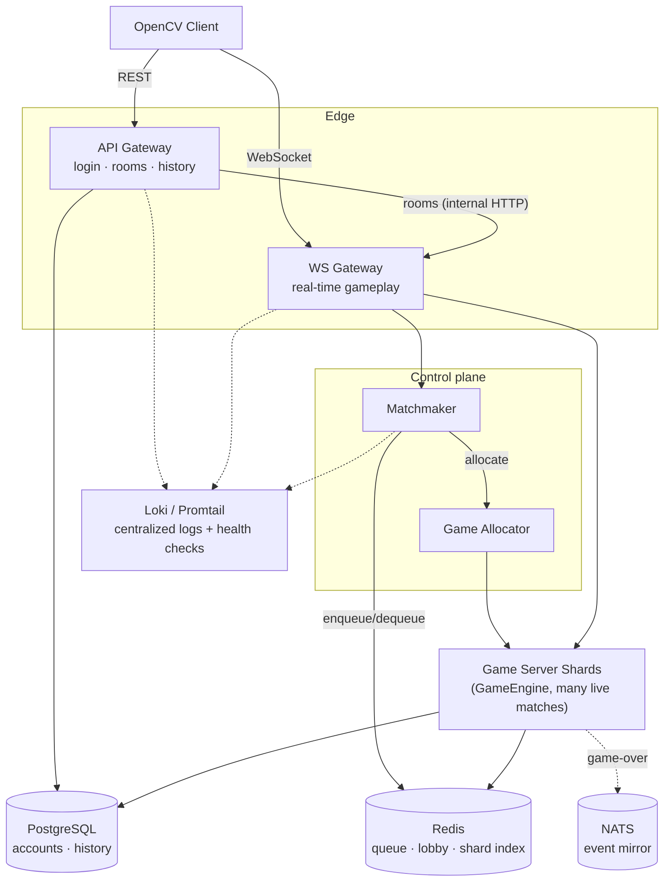

# KungFu Chess


A real-time chess variant — pieces move independently and simultaneously, gated by per-piece movement/rest cooldowns instead of alternating turns — with a server-authoritative C++ engine and a cloud-native, horizontally-shardable backend.

## Game Engine Design

Before any networking or cloud infrastructure, the core problem is: pieces move independently and simultaneously, each gated by its own travel time and cooldown — not alternating turns. A handful of design decisions make that work cleanly.

**Time-based move completion, not a turn state machine.** A move's duration is `distance × MS_PER_CELL` (1000ms per cell); a jump is a fixed 1000ms airborne, followed by a 1000ms rest, while a normal move is followed by a 3000ms rest. `GameState` tracks every in-flight move/jump/rest against a single logical clock, advanced explicitly by `update(deltaMs)` on every server tick — **not** `std::chrono::now()`. Two pieces moving at once each complete independently, on their own schedule — the actual mechanic that makes the variant real-time instead of turn-based. It also makes the whole timing system deterministic and trivial to unit-test: a test fast-forwards with `update(100000)` instead of sleeping.

**Server-authoritative, full stop.** The client only ever sends a click or a jump intent. Every legality check (`RulesEngine` dispatching to one `PieceRule` per piece type — `RookRule`, `BishopRule`, `QueenRule`, `KingRule`, `KnightRule`, `PawnRule`, plus `CastlingRules`), every timing decision, and every outcome (`RealTimeArbiter`, which resolves whichever in-flight moves/jumps have reached their completion time each tick — captures, promotion, game-over) happens server-side. The client renders purely from broadcast events; it never decides anything. This is the one rule that carried unchanged into the cloud architecture below: *neither the client nor any Gateway ever decides game rules — the authoritative engine does.*

**Game logic has zero knowledge that a network exists.** `GameSession` and `RealTimeArbiter` only publish plain domain events — `MoveStartedEvent`, `PieceCapturedEvent`, `JumpLandedEvent`, `GameOverEvent`, and so on — onto an in-process `EventBus`. `NetworkPublisher` (WebSocket broadcast), `RatingUpdater` (ELO), and `NatsEventMirror` (cross-process event mirroring) are just independent subscribers to the same bus; nothing in the game loop imports a socket, a database, or a message queue. Rating updates, match history, and NATS mirroring were each added later with zero changes to the core game loop — the same decoupling principle the service split below scales up to process boundaries.

**One `PieceRule` per piece type.** `RulesEngine::isLegalMove` dispatches to whichever `PieceRule` owns that piece — a small, deliberate strategy-pattern choice that keeps each piece's movement logic independently testable and makes adding a new piece type a pure addition, not an edit to a growing `switch`.

## Cloud Architecture

The server is split into independently deployable services and runs identically through Docker Compose or Kubernetes.



| Service | Responsibility |
|---|---|
| **API Gateway** | Stateless REST: login/registration, rating lookup, match history, room creation/joining. Proxies room requests to WS Gateway's internal API. |
| **WS Gateway** | Holds the live WebSocket connection for a match's duration: game commands in, state broadcasts out. Runs `N` independent **Game Server Shards** in-process, each owning many concurrent matches; a `GameAllocator` places every new match on the least-loaded shard. |
| **Matchmaker** | Rating-based pairing (±100 ELO) from a Redis-backed queue, so the queue survives restarts and isn't pinned to one process. |
| **Shared data layer** | PostgreSQL (accounts, game history), Redis (matchmaking queue, lobby identity, cross-shard game/room index), NATS (game-over event mirroring). |
| **Observability** | Every service exposes `/health`; Loki + Promtail centralize logs from all of them. |

Each service is a thin `main.cpp` wiring real collaborators together — the game engine above, the matchmaking logic, and the room/match registry are plain, independently unit-tested C++ classes with no networking code in them.

## Engineering highlights

A few examples from the build process (full log in `Implementation_Roadmap.md`, Hebrew):
- Found and fixed a race condition between two processes both running `CREATE TABLE IF NOT EXISTS` concurrently against Postgres on startup — not caught by any single-process test.
- Found a genuine thread-safety bug (a shared Redis connection with no locking) through careful reasoning after an integration test became flaky under concurrent WebSocket connections — not a guess-and-check fix.
- Traced an intermittent test crash (SIGABRT) to a timing assumption baked into the production WebSocket server code, by comparing against how the real server actually sequences its callbacks.

## Tech stack

**Server:** C++17, CMake · ixwebsocket (WebSocket) · httplib (REST) · hiredis (Redis) · libpqxx (PostgreSQL) · nats.c (NATS) · nlohmann/json · Catch2
**Client:** C++17, OpenCV
**Infrastructure:** Docker Compose · Kubernetes (`k8s/`) · PostgreSQL · Redis · NATS · Grafana Loki + Promtail · GitHub Actions

## Running it

**Docker Compose** (recommended — runs the full distributed system):
```powershell
docker compose up --build
```
Brings up Postgres, Redis, NATS, Loki/Promtail, and all three server processes (`ApiGateway` on :8081, `WsGateway` on :8080, `MatchmakerServer`), then runs the full test suite against the real stack.

**Kubernetes:**
```powershell
kubectl apply -f k8s/
```
Deploys the same system onto a cluster (tested against Docker Desktop's built-in Kubernetes).

**Native build** (Windows, single process — simplest path for client development):
```powershell
cd server
cmake -B build
cmake --build build --config Debug
./build/Debug/KungFuChessServer.exe
```
Same game engine, no Postgres/Redis/NATS required (falls back to SQLite and in-memory stores). See [`ui/CTD26-main/client/`](ui/CTD26-main/client/) for the client build.

## Testing

546 automated test cases (Catch2): pure unit tests for the game engine, matchmaking, and rating logic; integration tests against real containerized Postgres/Redis/NATS; and process-split tests that start the actual `ApiGateway`/`WsGateway`/`MatchmakerServer` binaries and verify they talk to each other correctly over the network. Runs automatically on every push via GitHub Actions (`.github/workflows/ci.yml`).

```powershell
cd server/build
ctest -C Debug --output-on-failure
```

## Project structure

```
server/
  logic/                 real-time game engine: GameState, RulesEngine/PieceRule, RealTimeArbiter, Controller
  auth/, rooms/, lobby/, matches/   login/session, rooms, matchmaking, match registry & sharding
  network/                HTTP server, WebSocket server, wire protocol
  db/                     PostgreSQL / SQLite player accounts
  rating/                 ELO calculation and updates
  *_main.cpp              one thin entry point per deployable service
  tests/unit/              mirrors the structure above

shared/        code identical on client and server: board/position model, event bus, JSON event
               serialization, file logger

ui/CTD26-main/client/   OpenCV rendering, input, animation, client-side networking

k8s/                       Kubernetes manifests, one file per service
.github/workflows/ci.yml   build + full test suite on every push
docker-compose.yml, server/Dockerfile
```

## Documentation

- [`Server_Design.md`](Server_Design.md) *(Hebrew)* — target cloud architecture and the reasoning behind it
- [`Implementation_Roadmap.md`](Implementation_Roadmap.md) *(Hebrew)* — phase-by-phase build log: what was built, real bugs found and fixed along the way, and why

## Status

**Implemented:** real-time server-authoritative gameplay; rating-based matchmaking; rooms (create/join, including over REST); disconnect-grace reconnection; load-based multi-shard match allocation; PostgreSQL/Redis/NATS wired for real; centralized logging and health checks; Docker Compose and Kubernetes deployment; CI.

## Roadmap

What's deliberately scoped out so far, and why:
- **Metrics, dashboards, and load testing** — today's observability is logs + health checks only. Deferred until there's a real traffic pattern to size dashboards and alert thresholds against, rather than guessing at numbers.
- **True multi-node sharding** — today's shards are load-balanced but co-located in one `WsGateway` process; splitting them across real nodes needs network-level routing, not just in-process allocation.
- **Horizontal autoscaling (HPA) / Agones-managed shard lifecycle** — needs the metrics above to scale against first.
- **Token-based auth and rate limiting** on the public API, ahead of any real external exposure.

## License

MIT — see [`LICENSE`](LICENSE).
