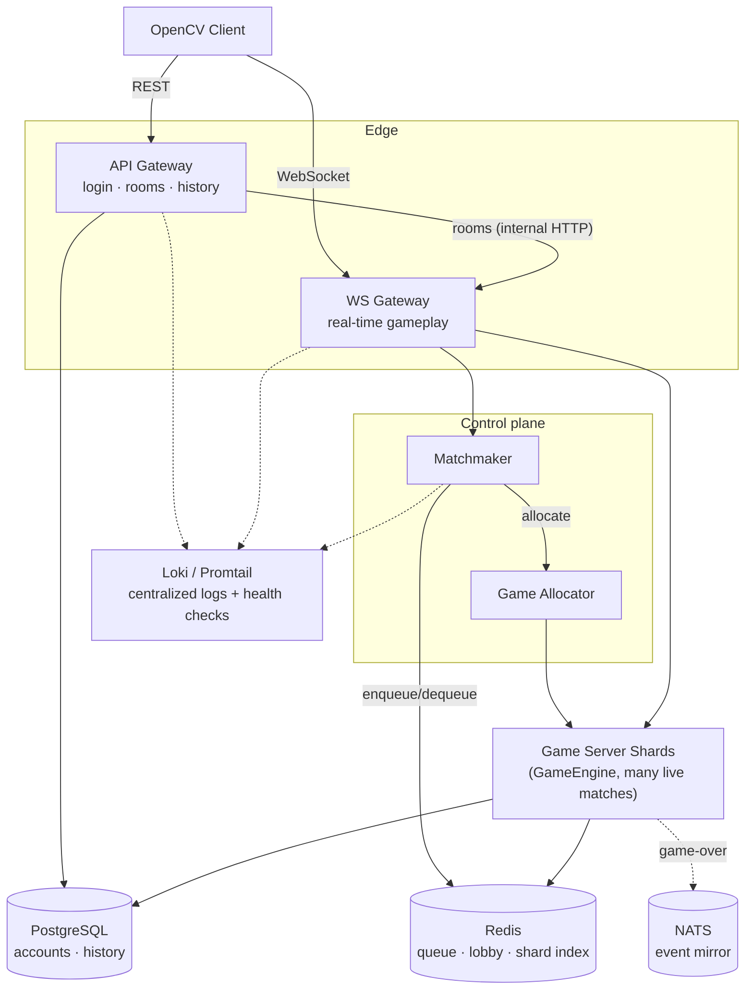

# KungFu Chess


A real-time chess variant where pieces move independently and simultaneously, gated by per-piece movement and rest cooldowns instead of alternating turns.

Built on a server-authoritative C++ engine and a containerized, multi-service backend with load-based match sharding.

**Tech stack:** C++17 · CMake · WebSocket · PostgreSQL · Redis · NATS · Docker · Kubernetes · OpenCV

https://github.com/user-attachments/assets/3a96930e-9872-4153-8238-6ed714c952e6

## Game Engine Design

Before any networking or cloud infrastructure, the core problem is pieces moving independently and simultaneously, each gated by its own travel time and cooldown instead of alternating turns. A few design decisions make that work.

**Time-based move completion, not a turn state machine.** A move's duration is `distance × MS_PER_CELL` (1000ms per cell). A jump is a fixed 1000ms airborne, followed by a 1000ms rest; a normal move is followed by a 3000ms rest. `GameState` tracks every in-flight move, jump, and rest against a single logical clock, advanced explicitly by `update(deltaMs)` on every server tick, not `std::chrono::now()`. Two pieces moving at once each complete independently, on their own schedule, which is what makes the variant real-time instead of turn-based. It also makes the timing system deterministic and easy to unit test: a test fast-forwards with `update(100000)` instead of sleeping.

**Server-authoritative.** The client only ever sends a click or a jump intent. Every legality check (`RulesEngine` dispatching to one `PieceRule` per piece type: `RookRule`, `BishopRule`, `QueenRule`, `KingRule`, `KnightRule`, `PawnRule`, plus `CastlingRules`), every timing decision, and every outcome (`RealTimeArbiter`, which resolves whichever in-flight moves and jumps have reached their completion time each tick: captures, promotion, game-over) happens server-side. The client renders purely from broadcast events and never decides anything. This principle carried unchanged into the cloud architecture below: neither the client nor any Gateway ever decides game rules; the authoritative engine does.

**Game logic has no knowledge that a network exists.** `GameSession` and `RealTimeArbiter` only publish plain domain events (`MoveStartedEvent`, `PieceCapturedEvent`, `JumpLandedEvent`, `GameOverEvent`, and others) onto an in-process `EventBus`. `NetworkPublisher` (WebSocket broadcast), `RatingUpdater` (ELO), and `NatsEventMirror` (cross-process event mirroring) are independent subscribers to the same bus. Nothing in the game loop imports a socket, a database, or a message queue. Rating updates, match history, and NATS mirroring were each added later with no changes to the core game loop, the same decoupling principle the service split below extends to process boundaries.

**One `PieceRule` per piece type.** `RulesEngine::isLegalMove` dispatches to whichever `PieceRule` owns that piece: a strategy-pattern choice that keeps each piece's movement logic independently testable, and makes adding a new piece type an addition rather than an edit to a growing `switch`.

## Cloud Architecture

The server is split into independently deployable services and runs identically through Docker Compose or Kubernetes.



| Service | Responsibility |
|---|---|
| **API Gateway** | Stateless REST: login/registration, rating lookup, match history, room creation/joining. Proxies room requests to WS Gateway's internal API. |
| **WS Gateway** | Holds the live WebSocket connection for a match's duration: game commands in, state broadcasts out. Runs `N` independent **Game Server Shards** in-process, each owning many concurrent matches; a `GameAllocator` places every new match on the least-loaded shard. |
| **Matchmaker** | Rating-based pairing (±100 ELO) from a Redis-backed queue, so the queue survives restarts and isn't pinned to one process. |
| **Shared data layer** | PostgreSQL (accounts, game history), Redis (matchmaking queue, lobby identity, cross-shard game/room index), NATS (game-over event mirroring). |
| **Observability** | Every service exposes `/health`; Loki + Promtail centralize logs from all of them. |

Each service is a thin `main.cpp` wiring real collaborators together. The game engine above, the matchmaking logic, and the room/match registry are plain, independently unit-tested C++ classes with no networking code in them.

## Engineering highlights

A few examples from the build process (full log in `Implementation_Roadmap.md`, Hebrew):
- Fixed a race condition between two processes both running `CREATE TABLE IF NOT EXISTS` against Postgres on startup, which only showed up when both services started together.
- Fixed a thread-safety bug in a shared Redis connection, diagnosed after an integration test became flaky under concurrent WebSocket connections.
- Traced an intermittent test crash (SIGABRT) to a timing assumption in the WebSocket server's connection-handling code, by comparing it against how the production server actually sequences its callbacks.

## Tech stack

**Server:** C++17, CMake · ixwebsocket (WebSocket) · httplib (REST) · hiredis (Redis) · libpqxx (PostgreSQL) · nats.c (NATS) · nlohmann/json · Catch2
**Client:** C++17, OpenCV
**Infrastructure:** Docker Compose · Kubernetes (`k8s/`) · PostgreSQL · Redis · NATS · Grafana Loki + Promtail · GitHub Actions

## Prerequisites

- Docker Desktop (for the Docker Compose / Kubernetes paths)
- CMake 3.16+
- A C++17 toolchain (Visual Studio 2022 on Windows)
- OpenCV 4.5.1, for the client only: download from [this folder](https://drive.google.com/drive/folders/14SeyjbNPvsgyLKM2omcVTlTX0wAQ-_Ox?usp=sharing) and place it under `ui/CTD26-main/client/OpenCV_451`

## Running it

**Docker Compose** (recommended, runs the full distributed system):
```powershell
docker compose up --build
```
Brings up Postgres, Redis, NATS, Loki/Promtail, and all three server processes (`ApiGateway` on :8081, `WsGateway` on :8080, `MatchmakerServer`), then runs the full test suite against the real stack.

**Kubernetes:**
```powershell
kubectl apply -f k8s/
```
Deploys the same system onto a cluster (tested against Docker Desktop's built-in Kubernetes).

**Native build** (Windows, single process, simplest path for local development):
```powershell
cd server
cmake -B build
cmake --build build --config Debug
cd build
./Debug/KungFuChessServer.exe
```
Same game engine, no Postgres/Redis/NATS required (falls back to SQLite and in-memory stores).

**Client** (needed to actually play, after starting a server above):
```powershell
cd ui/CTD26-main/client
cmake -B build
cmake --build build --config Debug
cd build
./Debug/KungFuChess.exe
```
Run two instances to play against yourself locally. Controls: left-click to select or move a piece, right-click to jump.

## Testing

546 automated test cases (Catch2): pure unit tests for the game engine, matchmaking, and rating logic; integration tests against real containerized Postgres/Redis/NATS; and process-split tests that start the actual `ApiGateway`/`WsGateway`/`MatchmakerServer` binaries and verify they talk to each other correctly over the network. Runs automatically on every push via GitHub Actions (`.github/workflows/ci.yml`).

```powershell
cd server/build
ctest -C Debug --output-on-failure
```

## Project structure

```
server/
  logic/                 real-time game engine: GameState, RulesEngine/PieceRule, RealTimeArbiter, Controller
  auth/, rooms/, lobby/, matches/   login/session, rooms, matchmaking, match registry & sharding
  network/                HTTP server, WebSocket server, wire protocol
  db/                     PostgreSQL / SQLite player accounts
  rating/                 ELO calculation and updates
  *_main.cpp              one thin entry point per deployable service
  tests/unit/              mirrors the structure above

shared/        code identical on client and server: board/position model, event bus, JSON event
               serialization, file logger

ui/CTD26-main/client/   OpenCV rendering, input, animation, client-side networking

k8s/                       Kubernetes manifests, one file per service
.github/workflows/ci.yml   build + full test suite on every push
docker-compose.yml, server/Dockerfile
```

## Documentation

- [`Server_Design.md`](Server_Design.md) *(Hebrew)*: target cloud architecture and the reasoning behind it
- [`Implementation_Roadmap.md`](Implementation_Roadmap.md) *(Hebrew)*: phase-by-phase build log: what was built, real bugs found and fixed along the way, and why

## Status

**Implemented:** real-time server-authoritative gameplay; rating-based matchmaking; rooms (create/join, including over REST); disconnect-grace reconnection; load-based multi-shard match allocation; PostgreSQL/Redis/NATS wired for real; centralized logging and health checks; Docker Compose and Kubernetes deployment; CI; on-screen move log and score in the client.

## Roadmap

What's deliberately scoped out so far, and why:
- **Metrics, dashboards, and load testing:** today's observability is logs + health checks only. Deferred until there's a real traffic pattern to size dashboards and alert thresholds against, rather than guessing at numbers.
- **True multi-node sharding:** today's shards are load-balanced but co-located in one `WsGateway` process; splitting them across real nodes needs network-level routing, not just in-process allocation.
- **Horizontal autoscaling (HPA) / Agones-managed shard lifecycle:** needs the metrics above to scale against first.
- **Token-based auth and rate limiting** on the public API, ahead of any real external exposure.

## License

MIT — see [`LICENSE`](LICENSE).
